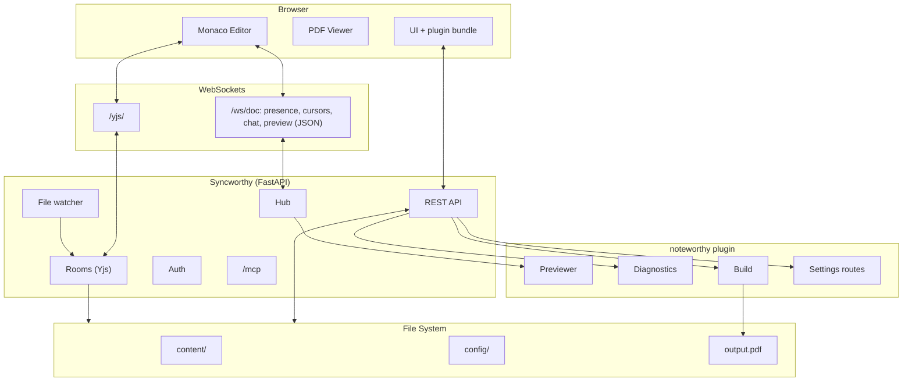

# Noteworthy Studio Stack

Architecture of Noteworthy Studio, the web GUI started by `noteworthy -g`.

## Overview

Studio is **[Syncworthy](https://github.com/R0K0R/syncworthy) with Noteworthy as
a plugin**. Syncworthy is a real-time collaborative editor for any project
(Monaco + Yjs, one CRDT room per file, presence, cursors, chat, an MCP endpoint,
a file watcher, token auth). Everything specific to Typst books lives in
`noteworthy/syncworthy_plugin/`. The old built-in GUI (`noteworthy/gui/`), the
solo GUI (`gui_solo/`, `-nc`) and the Emacs bridge (`noteworthy/bridge/`) were
removed.

| Layer         | Technology                                          | Where |
| ------------- | --------------------------------------------------- | ----- |
| **Backend**   | FastAPI + Python                                    | Syncworthy |
| **Real-time** | Two WebSockets: JSON presence + binary Yjs CRDT     | Syncworthy |
| **Frontend**  | HTML + CSS + JavaScript (ES modules)                | Syncworthy, plus the plugin bundle |
| **Editor**    | Monaco Editor + Yjs (`y-monaco` binding)            | Syncworthy |
| **Preview**   | Incremental SVG (`typst watch`) / Tinymist / PDF.js | the plugin |
| **Build, diagnostics, settings pages, Typst grammar** | | the plugin |

## Getting Syncworthy

Syncworthy is not on PyPI. `noteworthy -g` needs it importable, and says how if
it is not. Any one of:

- **`nix develop`**: the dev shell puts a checkout on `PYTHONPATH`: `$SYNCWORTHY_SRC`,
  else `../syncworthy`, else the `syncworthy` flake input
  (`github:R0K0R/syncworthy`, pinned in `flake.lock`).
- **pip / uv**: `pip install 'noteworthy[gui]'` or `uv sync --extra gui` fetch it
  from `git+https://github.com/R0K0R/syncworthy` (declared in `pyproject.toml`).
- **A checkout**: `pip install -e /path/to/syncworthy`, or
  `export PYTHONPATH=/path/to/syncworthy:$PYTHONPATH`.

Syncworthy needs Python 3.11 or newer.

## How the plugin plugs in

`noteworthy -g` calls `syncworthy.run_server(BASE_DIR, ..., plugins=[NoteworthyPlugin()])`.
The plugin is also registered under the entry-point group `syncworthy.plugins`
(`noteworthy = "noteworthy.syncworthy_plugin:NoteworthyPlugin"` in
`pyproject.toml`), so `syncworthy serve <project>` with `plugins = ["noteworthy"]`
in the project's `syncworthy.toml` works once both are installed. The plugin
interface is documented in Syncworthy's
[`docs/PLUGINS.md`](https://github.com/R0K0R/syncworthy/blob/master/docs/PLUGINS.md).

A Noteworthy project is the checkout the `noteworthy` package lives in
(`noteworthy.config` resolves every path from there), so that is the directory
Syncworthy serves.

| Plugin hook (`NoteworthyPlugin`) | Noteworthy's use |
| --- | --- |
| `state_dir` | `.noteworthy-crdt/`, so existing projects keep their CRDT state |
| `roots`, `tree_ignore`, `ignore` | the tree shows `assets`, `config`, `content`, `templates`, no dotfiles |
| `previewer` | per-page SVG preview (`typst watch`) and the Tinymist full-document preview |
| `diagnostics` | `POST /api/check`, Typst diagnostics as editor markers |
| `actions()` | the **Build PDF** page (`POST /api/build`, progress events) |
| `settings_pages()` | Metadata, Theme & Display, Structure, Color Themes, Snippets, Preface, Ignored, Modules, Info |
| `mcp_tools()` | `render_document`, `check_document` |
| `languages()` | a Typst Monarch grammar for Monaco |
| `branding()` | welcome text, themes, `.typ` defaults |
| `routers()` | the settings, build, download and Tinymist endpoints below |
| `static_dir` | the frontend bundle, served at `/plugins/noteworthy/` |

Source layout: `__init__.py` (the plugin), `previewer.py` and `preview.py`,
`diagnostics.py`, `build.py`, `routes.py`, `settings_routes.py`, `mcp_tools.py`,
`branding.py`, `startup.py`, `typst_grammar.py`, `static/`.

## Architecture Diagram



---

## Endpoints

**Syncworthy (generic):**

| Endpoint                 | Method   | Purpose                                      |
| ------------------------ | -------- | -------------------------------------------- |
| `/api/file`              | GET/POST | Read/write a file (create with POST)         |
| `/api/tree`              | GET      | File tree                                    |
| `/api/rename`            | POST     | Rename file or folder                        |
| `/api/delete`            | POST     | Delete file or folder                        |
| `/api/upload`            | POST     | Upload file                                  |
| `/api/rooms/reload`      | POST     | Reconcile live rooms with the files on disk  |
| `/api/app`               | GET      | Branding, plugin capabilities, auth role     |
| `/api/status`            | GET      | Server + plugin status                       |
| `/api/debug/yjs`         | GET      | Yjs room introspection                       |
| `/api/check`             | POST     | Diagnostics (served by the plugin's checker) |
| `/api/actions/{id}`      | POST     | Run a plugin action (Build)                  |
| `/api/settings/{id}`     | GET/POST | Schema-driven plugin settings pages          |
| `/mcp`                   | POST     | MCP, see below                               |
| `/auth/logout`           | -        | Clears the session cookie                    |

**Added by the Noteworthy plugin** (`routes.py`, `settings_routes.py`):

| Endpoint                       | Method   | Purpose                       |
| ------------------------------ | -------- | ----------------------------- |
| `/api/structure`               | GET      | Chapter/page structure        |
| `/api/metadata`                | GET/POST | Document metadata             |
| `/api/constants`               | GET/POST | Theme and display options     |
| `/api/hierarchy`               | GET/POST | Chapter structure             |
| `/api/preface`                 | GET/POST | Preface content               |
| `/api/snippets`                | GET/POST | Custom snippets               |
| `/api/indexignore`             | GET/POST | Build exclusions              |
| `/api/schemes`                 | GET      | Available themes              |
| `/api/schemes/active`          | POST     | Set the current theme         |
| `/api/schemes/{name}`          | GET/POST | Single theme definition       |
| `/api/modules`                 | GET      | Module list                   |
| `/api/modules/{name}/config`   | GET/POST | Per-module settings           |
| `/api/build`                   | POST     | Trigger build                 |
| `/api/download/output.pdf`     | GET      | Download built PDF            |
| `/api/watch`                   | POST     | Start preview watch           |
| `/api/tinymist/start`          | POST     | Start full-document preview   |
| `/api/tinymist/stop`           | POST     | Stop full-document preview    |
| `/api/tinymist/status`         | GET      | Tinymist preview status       |

**WebSockets:**

| Endpoint      | Payload | Purpose                                     |
| ------------- | ------- | ------------------------------------------- |
| `/ws/doc`     | JSON    | Presence, cursors, chat, preview, build log |
| `/yjs/<room>` | Binary  | CRDT content sync, one room per file path   |

The two sockets are strictly separated: `/ws/doc` never carries document
content, and `/yjs` never carries chat or presence. Concurrent edits converge
through the CRDT, so there is no save lock, no canonical server text and no
acknowledgement step. Room naming is described in the
[emacs-collab protocol](https://github.com/R0K0R/emacs-collab.el/blob/master/PROTOCOL.md)
and `syncworthy_bridge`'s README.

## Rooms, the file watcher and MCP

- A live room is authoritative and rewrites its file shortly after every edit.
- Syncworthy's **file watcher** merges an external edit to a file with a live
  room into the room (a minimal-diff reload), so editors see an edit rather
  than a swapped buffer. Its own saves are recognised and not fed back.
- **MCP** is `POST /mcp` (Streamable HTTP). Syncworthy provides
  `list_documents`, `read_document`, `edit_document` and `append_document`,
  which go through the rooms; the plugin adds `render_document` and
  `check_document`. Auth is a bearer token from `$NOTEWORTHY_MCP_TOKEN` (the
  plugin's variable), else `$SYNCWORTHY_MCP_TOKEN` (or `..._FILE`). With no
  token the endpoint fails closed.

```bash
claude mcp add --transport http noteworthy http://<host>:8000/mcp \
  --header "Authorization: Bearer $NOTEWORTHY_MCP_TOKEN"
```

## Frontend

Syncworthy's `static/js/app.js` and its modules (collaboration, file tree, chat,
languages) form the shell; one Monaco is vendored under Syncworthy's
`static/vendor/`. The plugin's bundle (`syncworthy_plugin/static/`:
`config.js`, `build.js`, `preview.js`, `noteworthy.js`) registers itself through
`Syncworthy.registerPlugin` and mixes its methods into the app.

| Plugin file     | Purpose                                                  |
| --------------- | -------------------------------------------------------- |
| `config.js`     | Metadata, constants, structure, schemes, module settings |
| `build.js`      | Build grid, progress, PDF download                       |
| `preview.js`    | SVG and Tinymist preview panes                           |
| `noteworthy.js` | Registration and glue                                    |

## Preview

- The SVG watcher recompiles on file change and pushes only changed pages.
- At most 3 concurrent watchers; the least recently used is retired.
- The Tinymist full preview runs as a separate process on a dynamically chosen
  port (from 23625 upward) and is embedded through an iframe.

---

## Security

Syncworthy has token authentication. See its
[README](https://github.com/R0K0R/syncworthy#auth).

- Tokens have a role: `edit`, or `view` (reads, sees presence, chats; its Yjs
  updates are dropped and write requests refused). They come from
  `syncworthy.toml` (`[auth] tokens = [{ name, token_env | token_file, role }]`)
  or from `SYNCWORTHY_EDIT_TOKEN` / `SYNCWORTHY_VIEW_TOKEN` (and `..._FILE`);
  secrets never go in the toml.
- A browser opens `http://host:port/?token=...` once and receives an HttpOnly
  cookie; scripts send `Authorization: Bearer ...`. Enforced on `/yjs`,
  `/ws/doc`, `/api/*` and the static files. `/mcp` keeps its own token.
- With no tokens the server is open. That is allowed only on a loopback bind
  (the default `--bind 127.0.0.1`). On any other address it refuses to start
  unless tokens are set or `--insecure-open` is passed.
- WebSockets from another origin are refused.
- Prefer a VPN or Tailscale over a public tunnel; this also gives you HTTPS,
  which browsers require before they will finalize PDF downloads.

---

## See Also

- [Architecture Overview](overview.md)
- [Collaboration Guide](../guides/collaboration.md)
- [Building Guide](../guides/building.md)
- [Emacs protocol (retired) and the replacement](../reference/emacs-protocol.md)
