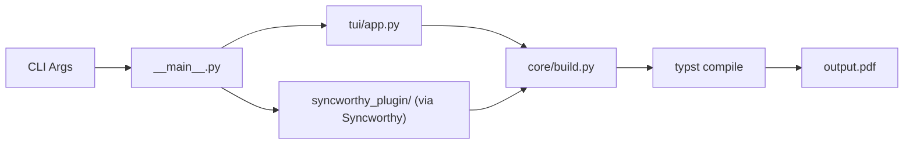

# Python Layer

Deep dive into the `noteworthy/` Python package.

## Package Structure

```
noteworthy/
├── __init__.py
├── __main__.py       # Entry point
├── config.py         # Path constants
├── utils.py          # Shared utilities
│
├── core/             # Build engine
│   ├── build.py
│   ├── build_manager.py
│   ├── config_mgmt.py
│   ├── deps.py
│   ├── fs_sync.py
│   ├── modules.py
│   ├── pm.py
│   ├── sync.py
│   └── templates.py
│
├── tui/              # Terminal UI
│   ├── app.py
│   ├── base.py
│   ├── keybinds.py
│   ├── menus.py
│   ├── components/
│   ├── editors/
│   └── wizards/
│
└── syncworthy_plugin/  # Web GUI: the Noteworthy plugin for Syncworthy
    ├── __init__.py       # NoteworthyPlugin
    ├── previewer.py, preview.py   # SVG / tinymist preview
    ├── diagnostics.py    # /api/check
    ├── build.py          # Build PDF action
    ├── routes.py, settings_routes.py
    ├── mcp_tools.py      # render_document, check_document
    ├── branding.py, startup.py, typst_grammar.py
    └── static/
```

---

## Entry Point

### __main__.py

The main entry point handles:

1. **Argument parsing** — `-g`, `-u`, `-p`, etc.
2. **Update logic** — Downloads from GitHub
3. **Mode dispatch** — TUI, Studio, or CLI

```python
def main():
    parser = argparse.ArgumentParser()
    parser.add_argument('-g', '--gui', ...)
    parser.add_argument('-u', '--update', ...)
    args = parser.parse_args()
    
    if args.update:
        # Run update flow
    elif args.gui:
        from syncworthy import run_server
        from .syncworthy_plugin import NoteworthyPlugin
        run_server(BASE_DIR, port=args.port, plugins=[NoteworthyPlugin()])
    else:
        # Launch TUI
        curses.wrapper(lambda scr: run_app(scr, args))
```

---

## Core Module

### config.py

Defines project path constants:

```python
BASE_DIR = Path.cwd()
BUILD_DIR = BASE_DIR / "build"
OUTPUT_FILE = BASE_DIR / "output.pdf"
METADATA_FILE = BASE_DIR / "config/metadata.json"
CONSTANTS_FILE = BASE_DIR / "config/constants.json"
HIERARCHY_FILE = BASE_DIR / "config/hierarchy.json"
# ...
```

### utils.py

Shared utilities:

| Function             | Purpose                       |
| -------------------- | ----------------------------- |
| `load_config_safe()` | Load JSON with error handling |
| `scan_content()`     | Scan content/ directory       |
| `generate_updater()` | Create update script          |

### core/build.py

Typst compilation logic:

| Function                | Purpose                 |
| ----------------------- | ----------------------- |
| `compile_target()`      | Run `typst compile`     |
| `merge_pdfs()`          | Combine PDFs with pdftk |
| `create_pdf_metadata()` | Generate bookmarks      |
| `apply_pdf_metadata()`  | Apply to PDF            |
| `get_pdf_page_count()`  | Count pages             |

### core/build_manager.py

Parallel build orchestration:

```python
class BuildManager:
    def build_parallel(self, chapters, config, opts, callbacks):
        # Parallel compilation with thread pool
        with ThreadPoolExecutor(max_workers=opts['threads']) as executor:
            futures = [executor.submit(compile_chapter, ch) for ch in chapters]
            # ...
```

### core/deps.py

Dependency checking:

```python
def check_dependencies():
    # Check for typst, pdftk, pdfinfo
    # Return missing dependencies
```

### core/pm.py

Package manager for modules:

| Function                      | Purpose                                 |
| ----------------------------- | --------------------------------------- |
| `ensure_module_cache()`       | Clone/update modules repo cache         |
| `get_module_sha_from_cache()` | Get git tree SHA for a module           |
| `check_module_updates()`      | Compare local vs remote SHAs            |
| `resolve_all_dependencies()`  | DFS with cycle detection                |
| `get_required_dependencies()` | Force-required dependencies             |
| `install_modules()`           | Install with auto-dependency resolution |
| `normalize_config()`          | Enforce schema on save                  |
| `sync_modules_config()`       | Sync with remote + local filesystem     |

#### Dependency Resolution

Uses DFS with cycle detection:

```python
def resolve_all_dependencies(module_names, include_requested=True):
    """
    Returns topologically sorted list (deps first).
    Cycles are detected and logged but don't prevent installation.
    """
    visited = set()
    in_stack = set()  # For cycle detection
    result = []
    
    def dfs(module, path):
        if module in in_stack:
            # Cycle detected
            return
        # ... traverse dependencies
    
    return ordered, cycles
```

#### Config Normalization

Strips runtime metadata, enforces unified schema:

```python
def normalize_config(config):
    # Only keeps: status, source, sha
    # Removes: version, description, dependencies, exports
```

---

## TUI Module

The terminal interface is built with Python's `curses`.

### tui/app.py

Main TUI application loop.

### tui/base.py

Base UI components:

- `Screen` — Base screen class
- `Window` — Windowing abstraction
- `draw_box()` — Box drawing
- `draw_table()` — Table rendering

### tui/menus.py

Menu screens:

| Menu         | Purpose           |
| ------------ | ----------------- |
| `MainMenu`   | Home screen       |
| `BuildMenu`  | Chapter/page grid |
| `ConfigMenu` | Settings access   |

### tui/editors/

Configuration editors:

| Editor            | Edits          |
| ----------------- | -------------- |
| `ConfigEditor`    | metadata.json  |
| `HierarchyEditor` | hierarchy.json |
| `SchemeEditor`    | theme colors   |
| `SnippetsEditor`  | snippets.typ   |
| `BlueprintEditor` | module configs |

### tui/wizards/

Setup wizards:

| Wizard        | Purpose              |
| ------------- | -------------------- |
| `InitWizard`  | First-time setup     |
| `SyncWizard`  | Hierarchy sync       |
| `BuildWizard` | Build selection grid |

---

## Studio Module

The web interface is [Syncworthy](https://github.com/R0K0R/syncworthy) (FastAPI,
Yjs rooms, presence hub, MCP, file watcher, auth) with `syncworthy_plugin/` as
its Noteworthy plugin. Syncworthy is not part of this package; see
[Studio Stack](gui-stack.md) for how to provide it.

### syncworthy_plugin/__init__.py

`NoteworthyPlugin` declares the project layout (`roots`, `state_dir`), and
supplies the previewer, diagnostics, the Build action, settings pages, MCP tools,
the Typst grammar, branding and the frontend bundle.

### syncworthy_plugin/previewer.py, preview.py

Live preview management: `typst watch` SVG per page, the Tinymist full preview,
and update notifications through Syncworthy's hub.

### syncworthy_plugin/diagnostics.py, build.py

`/api/check` (Typst diagnostics) and the PDF build, with progress events.

### syncworthy_plugin/routes.py, settings_routes.py

The Noteworthy REST endpoints: metadata, constants, hierarchy, preface,
snippets, indexignore, schemes, modules, build, download, Tinymist control.

### syncworthy_plugin/mcp_tools.py

`render_document` and `check_document`. The other MCP tools (`list_documents`,
`read_document`, `edit_document`, `append_document`) are Syncworthy's.

---

## Data Flow



---

## See Also

- [Architecture Overview](overview.md)
- [Studio Stack](gui-stack.md)
- [CLI Reference](../reference/cli.md)
